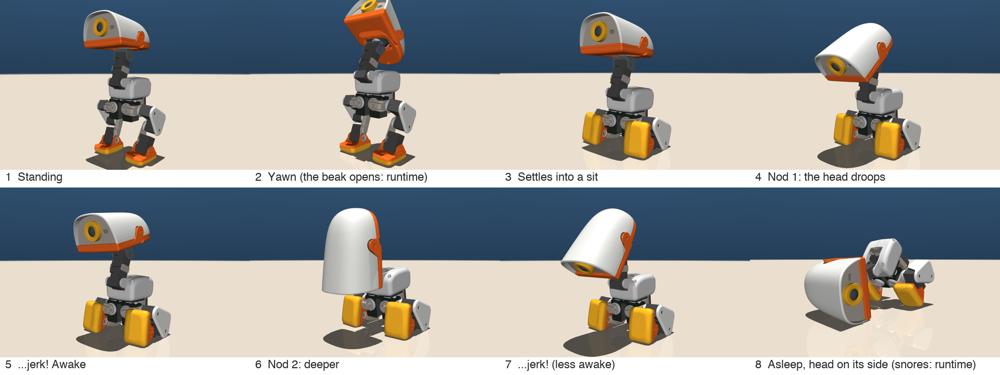

# Sleepy Duckling: design notes

Task id: `Mjlab-SleepyDuck-Flat-MicroDuck` (branch `sleepy-duck` of `microduck_rl`, built on `main`, which carries PoliteBow and PlayDead).

The trick: the duck yawns, settles into a sit and starts to nod off. Each nod goes a little deeper, with a small jerk as it catches itself, until it falls asleep with its beak on the floor and its bum in the air. A beat later it snuggles, rolling its head onto its cheek. Then it sleeps (and, on the robot, snores: see "The beak").



The files:

- `src/mjlab_microduck/tasks/microduck_sleepy_duck_env_cfg.py`: the task. The poses and the timeline are in the CONSTANTS block at the top.
- `src/mjlab_microduck/tasks/sleepy_duck_mdp.py`: the two terms PlayDead lacks (a two-way "tipped over" termination and a clock-gated "head resting" reward). Everything else is reused from `play_dead_mdp.py`.
- `tests/test_sleepy_duck_cfg.py`: config invariants, including "each nod deeper than the last".
- `scripts/sleepy_pose_study.py`: drops the duck into each pose in the training env (BAM servos) and checks where it settles; renders stills and the storyboard.
- `scripts/sleepy_duck_eval.py`: headless evaluation of the exported ONNX, with an optional MP4. It counts the nods and measures how sharp the jerks are.

## The timeline

| Time (s) | Beat | Head (nose-down vs trunk) | Head turn (yaw / roll) | Trunk pitch |
|---|---|---|---|---|
| 0.0 | standing (HOME) | 0° | 0° / 0° | 0° |
| 0.7–1.0 | yawn: nose up | −37° | 0° / 0° | 0° |
| 2.3 | sat down (the SitStand keyframe) | 0° | 0° / 0° | 0° |
| 3.1 / 3.3 | nod 1: droop / jerk | 23° / 9° | 9° / 7° | 0° |
| 4.3 / 4.5 | nod 2: droop / jerk | 43° / 21° | 17° / 14° | ~2° |
| 5.7 / 5.9 | nod 3: droop / jerk | 63° / 40° | 26° / 21° | ~4° |
| 7.6 | slumped asleep: beak on the floor, bum highest | — | 26° / 21° | 63° |
| 7.9 | a beat | — | 26° / 21° | 63° |
| 8.8 | snuggled: lying on its cheek | — | 80° / 0° | 60° |
| 10.5 | fast asleep: the episode ends | — | 80° / 0° | 60° |

Each keyframe blends into the next with a smoothstep. The droops are slow (0.8 to 1.2 s) and the jerks fast (0.2 s).

## Design choices

- **Three nods**, not two: more comic build-up, at some cost in learnability (below).
- **Head on its side when asleep**, the way an animal settles to sleep, rather than resting on the beak with the head straight (the first candidates).
- **Each nod turns the head a little further towards its sleeping side** (added for run 2, see below); the snuggle finishes the turn.
- **The snuggle comes after landing** (lands on its beak, then rolls its head onto its cheek), rather than turning on the way down. It is more expressive; the cost is that the head rolls along the floor, so `head_impact_cost` prices it (it charges head speed only while touching).
- **Snoring** once asleep: the runtime opens and closes the beak with a snore sound.

## Run 1 → run 2

**Run 1** (the design above without the head turn during the nods), checked at iteration 500 with the headless eval (64 ducks, from a still stand):

- learnt: no falls at all; the yawn almost exactly (−27°, −36°, −33° against −24°, −37°, −33°); the sit;
- **no nods:** the head sank slowly and steadily from 7° to 34° nose-down: the average of the three nods. Nod depth alone did not tell the nods apart: at the same head angle, nod 1 and nod 2 differ by only ~0.1 rad of neck;
- **no slump:** trunk upright at the end (2° against 58°), head never on the floor.

**Run 2** changes:

1. **A posture counter for the nods:** each nod turns the head further towards its sleeping side (yaw 9°, 17°, 26°; roll 7°, 14°, 21°), the catches keep the turn, and the snuggle finishes it. The head-turn term is tighter (std 0.25) with a stronger L1 pull (−0.5).
2. **Mid-routine starts (reverse curriculum):** 30% of training episodes start at rest in a keyframe pose (just sat, after nod 2, at the start of the slump, slumped on the beak; weighted 1:1:2:2), with the episode clock set to that keyframe. `bow_mdp._episode_time` accepts a per-env clock offset (no effect on tasks that don't set one) and a clock-based time-out ends those episodes with the routine. Mid-walk starts drop from 40% to 30%.
3. **Eval video** turns the duck to face the camera (resets give it a random heading) and reports the head turn at each nod.

## How it is taught

It works the same way as PlayDead: a hidden reference clock, a moving target, the clock given to the critic only, and no jackpots.

- **Head** (neck pitch + head pitch): the performance, so the tightest tracking (std 0.25 rad, weight 3) plus an L1 pull.
- **Trunk pitch:** upright through the nods, then the slump. This makes the slump a lowering, not a fall.
- **Legs:** stand, then sit, then stay sat. Generous std, as in PlayDead.
- **Head turn** (head yaw and roll): the nod counter, then the snuggle. Its own term, std 0.25 plus an L1 pull. PlayDead's head turn, at std 0.3 with no L1, only learnt after ~1,600 iterations.
- **Feet planted** for the whole episode, and **head resting** paid by the clock once the beak should have landed (never by state, so it cannot be farmed early).
- **Safety costs:** head speed while touching the floor (a slam or a scrub is expensive, resting is free), the head touching down before 7 s, roll, drift.
- **Termination:** the asleep pose leans forward ~60°, so the usual `fell_over` is removed. Tipping onto the back (< −40°, the yawn's risk), onto a side (> 45°) or on over the face (> 85°) ends the episode.
- **Smoothing** (action rate) is lighter than PlayDead's at the end of training: heavy smoothing would round off the jerks, and the jerks are the joke.
- **Symmetry loss is off:** the head snuggles onto one side only.
- **Mid-walk starts:** 40% of training episodes start from a real mid-walk state (PoliteBow v2's gait bank).

## What was checked in sim before choosing the numbers

With `scripts/sleepy_pose_study.py`: each pose dropped into the training env (groundcontact model, BAM servos) and held as a constant target for 3 s.

- **The plain MuJoCo servos are useless for this:** too soft to hold even the standing pose. Everything below uses the BAM model.
- **Standing needs a policy:** held open-loop, HOME tips onto the face within a second. The sit holds.
- **Signs:** neck_pitch − brings the head forward and down; head_pitch + is nose down. The head's nose-down angle is about −(neck − 0.349) + (head − 0.349) + trunk pitch.
- **Every sitting keyframe settles still** with both feet down (the `kf_*` candidates are built from the task's own keyframes).
- **The yawn:** neck +0.55 / head −0.45 (57° nose up) tips the *sitting* duck onto its back, so the yawn is done standing, at 37°.
- **Asleep:** the first candidates rested on the face (the camera!). Pitching the head back up as the neck goes forward puts the beak (the orange jaw) on the floor instead: trunk 56–62°, bum the highest point. With head yaw +1.4 the head lies flat on its cheek, face turned to the duck's left.

Not checked: the transitions. Whether the duck can slump softly, and roll its head without scrubbing, is what training finds out.

## The known risks

1. **Telling the nods apart.** The actor has no clock. Depth alone was not enough in run 1; run 2 adds the head-turn counter. If the eval still shows fewer than three nods, make the turn steps bigger (or go back to two nods).
2. **The last mile.** Run 1 never slumped by iteration 500; run 2 starts 30% of episodes mid-routine. If it still never slumps from a full episode, raise the share of slump-start spawns.
3. **The jerks get smoothed away** by the action-rate curriculum. Lower the final stage.
4. **The head slam or scrub.** If `head impact speed` stays above about 0.5 m/s, raise `sleepy_head_impact_cost` or lengthen the slump.
5. **The beak.** The jaw has no servo in the 14-joint action space, so the yawn's open beak and the snoring are the runtime's job, as for PlayDead.

## How to judge a run

- **In the log** (`status.sh`): every `*_cost` ≤ 0; `sleepy_head` and `sleepy_pitch` climbing; `sleepy_snuggle` climbing late; `tipped_over` falling towards 0; mean episode length reaching 525 steps.
- **With `fetch.sh`** (eval + video): toppled ≈ 0%, nods = 3, asleep and snuggled ≈ 100%, head impact low. Then watch the MP4.
- **Budget:** 3,000 iterations at 4,096 envs (about 2 to 3 hours). Checkpoints every 50 iterations, to see how the behaviour develops.

## Deploying it

```bash
uv run publish --onnx exports/sleepyduck-flat-N.onnx --repo drfonz-indigo/microduck-sleepy-duckling \
    --kind episodic --duration-s 10.5 --description "Yawns, sits, nods off three times and falls asleep on its cheek."
```

The final pose is static, so the runtime can keep the policy running while the duck sleeps, then hand over to the stand policy to wake it.
